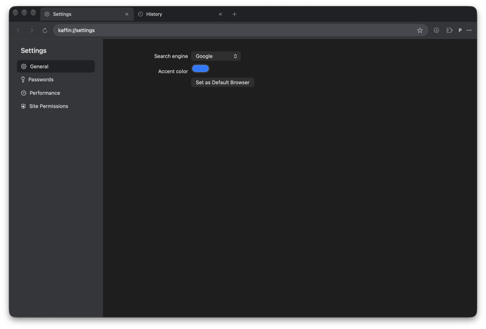

# KAFFIN Browser

A lightweight native browser for macOS, built with Swift, AppKit, SwiftUI, and WebKit. It has a Chrome-like interface and installs extensions from the Chrome Web Store.



> **Early release.** KAFFIN has been tested on one Mac so far. It is not signed with a Developer ID or notarized, and it does not update itself.

## Features

- **Tabs:** drag to reorder, pin, mute, duplicate, reopen, restore after restart, and move to a new window
- **Tab sleeping:** by hand, or automatically under memory pressure or after idle time
- **Address bar:** suggestions from history and bookmarks, with site icons and a choice of search engine
- **Extensions:** Chrome Web Store install with CRX signature verification, unpacked extensions, toolbar buttons, and update checks
- **Passwords:** stored in the macOS Keychain, and saved or filled only after a click
- **Privacy:** separate profiles, and private windows that store nothing and run no extensions
- **Site safety:** per-site camera, microphone, and location permissions, fraud warnings, and safer handling of links that open other apps
- **Everyday tools:** bookmarks with HTML import and export, history, resumable downloads, find, print, and zoom

## Install

Requires macOS 27 on Apple Silicon.

1. Download the latest DMG from [Releases](https://github.com/EmreSarikaya35/KAFFIN-Browser/releases).
2. Open it and drag **KAFFIN** to **Applications**.
3. Open KAFFIN. macOS blocks the first launch because the app is not notarized.
4. Go to **System Settings → Privacy & Security** and choose **Open Anyway**.

Only do this if you trust the download. To replace a version, quit KAFFIN and drag the new one over it. Your settings and data stay.

## Build from source

You need Xcode 27 and macOS 27.

```sh
git clone https://github.com/EmreSarikaya35/KAFFIN-Browser.git
cd KAFFIN-Browser
open KAFFIN.xcodeproj
```

Choose the **KAFFIN** scheme and run. The Debug build uses its own profile, `com.kaffin.browser.dev`.

```sh
cd KaffinKit && swift test   # run the tests
Scripts/make-dmg.sh          # build a DMG in build/, from the repository root
```

## Known limits

- Some Chrome extensions do not work, because WebKit's extension support differs from Chrome's. See [EXTENSION_COMPATIBILITY.md](Documentation/EXTENSION_COMPATIBILITY.md).
- Sites see WebKit, not Chrome, so a site that only supports Chrome may refuse or misbehave.
- Location reaches the main page only, not embedded frames.
- The interface is in English only, and the app has no icon yet.
- VoiceOver support has been checked through the accessibility tree, not in real use.

## Project layout

| Path                | Contents                                   |
| ------------------- | ------------------------------------------ |
| `App/`              | App entry point                            |
| `KaffinKit/Sources` | Browser code, as a local Swift package     |
| `KaffinKit/Tests`   | Unit and WebKit integration tests          |
| `Documentation/`    | Decisions, roadmap, and performance notes  |
| `Scripts/`          | DMG build script                           |

## Contributing

Issues and pull requests are welcome. Please run the tests first, and include your macOS version in bug reports.

## License

KAFFIN is released under the [MIT License](LICENSE). It uses [GRDB](https://github.com/groue/GRDB.swift), which is also MIT licensed. KAFFIN is not affiliated with Google or Chrome.
