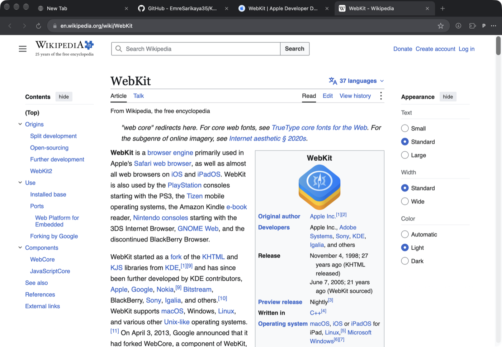
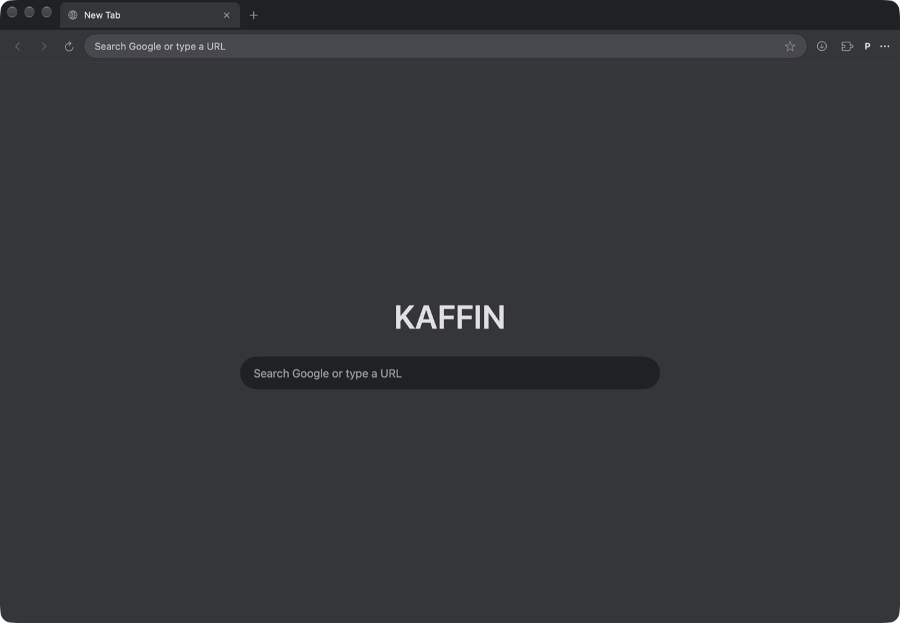
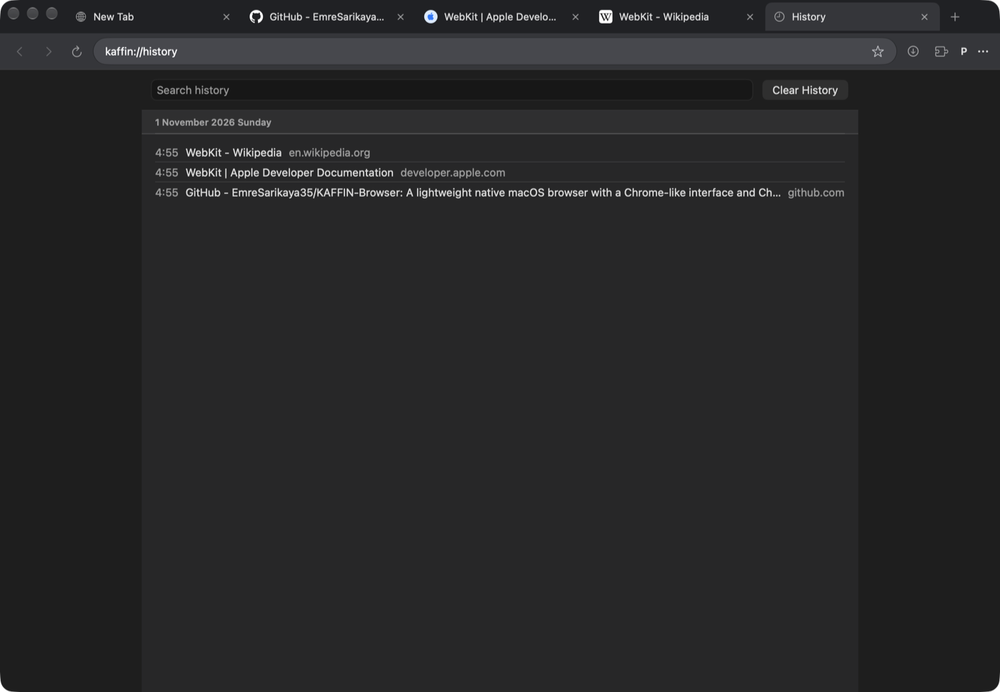
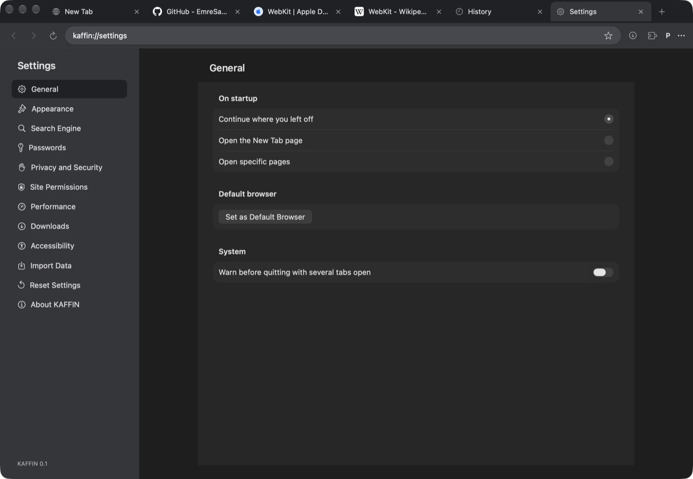
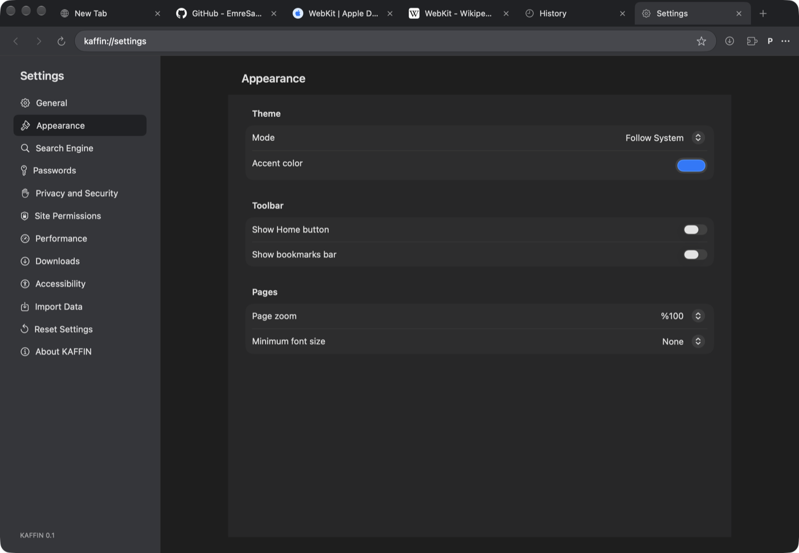
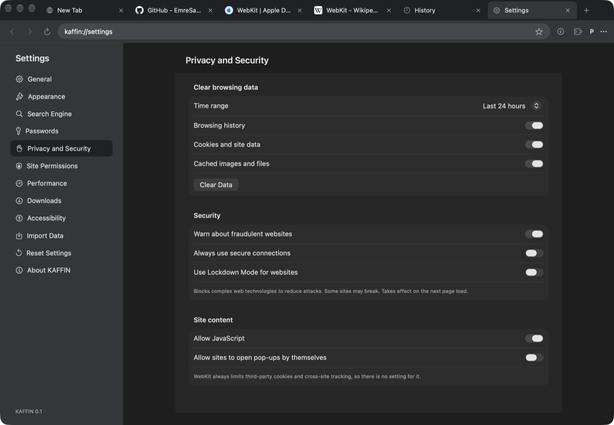
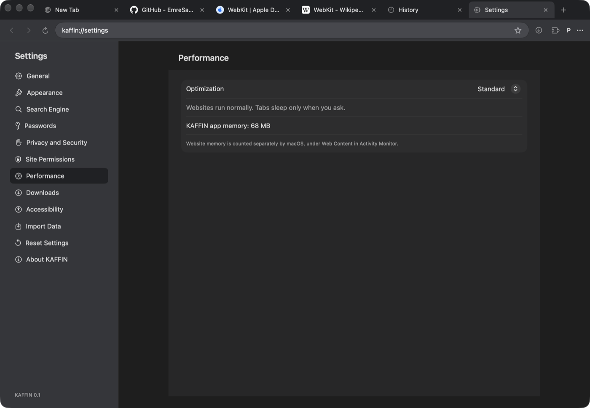
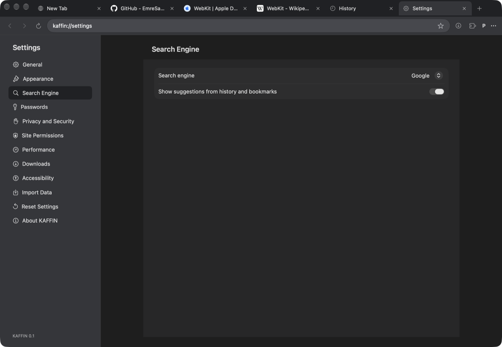
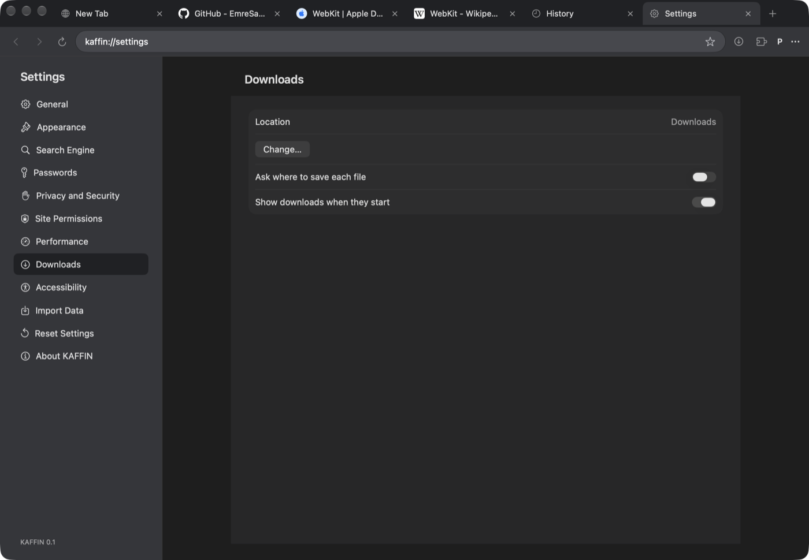
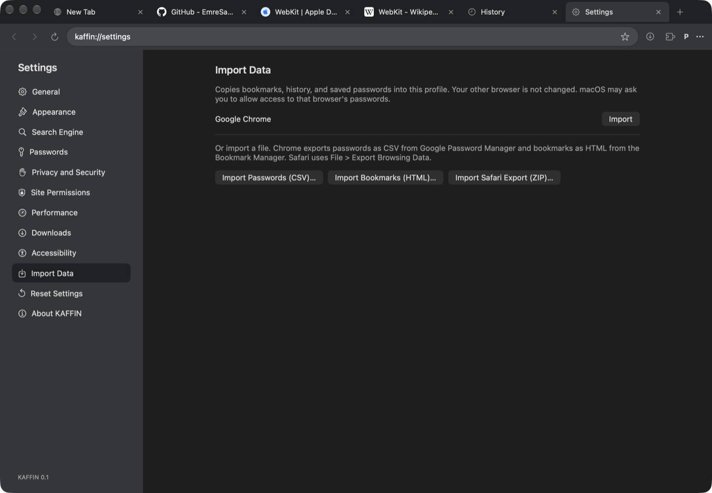

# KAFFIN Browser

A lightweight native browser for macOS, built with Swift, AppKit, SwiftUI, and WebKit. It looks and works like Chrome, installs extensions from the Chrome Web Store, and stays light on memory.

[](https://github.com/EmreSarikaya35/KAFFIN-Browser/releases/latest)
[](LICENSE)




> **Early release.** KAFFIN has been tested on one Mac so far. It is not signed with a Developer ID or notarized, and it does not update itself.

## Installation

**Requirements:** macOS 27 on Apple Silicon.

1. Download the latest `KAFFIN-x.y.z.dmg` from [Releases](https://github.com/EmreSarikaya35/KAFFIN-Browser/releases/latest).
2. Open the DMG and drag **KAFFIN** to **Applications**.
3. Open KAFFIN. macOS blocks the first launch because the app is not notarized.
4. Go to **System Settings → Privacy & Security** and choose **Open Anyway**.

Only do this if you trust the download. Each release lists the file's SHA-256, so you can check it with `shasum -a 256 KAFFIN-x.y.z.dmg`.

**Updating:** quit KAFFIN, then drag the new version over the old one. Your settings and data stay.

**Moving from another browser:** open **Settings → Import Data**. See [Importing your data](#importing-your-data).

## Contents

- [Screenshots](#screenshots)
- [Features](#features)
- [Importing your data](#importing-your-data)
- [Technologies](#technologies)
- [Architecture](#architecture)
- [Performance](#performance)
- [Privacy and security](#privacy-and-security)
- [Build from source](#build-from-source)
- [Known limits](#known-limits)
- [Roadmap](#roadmap)
- [Contributing](#contributing)
- [License](#license)

## Screenshots

| New Tab | History |
| --- | --- |
|  |  |

Settings and History open as normal tabs, not separate windows.

| General | Appearance |
| --- | --- |
|  |  |

| Privacy and Security | Performance |
| --- | --- |
|  |  |

| Search Engine | Downloads |
| --- | --- |
|  |  |

| Import Data |
| --- |
|  |

## Features

### Tabs and windows

- Drag to reorder, with small animations when tabs open, close, and move
- Pin, mute, duplicate, reopen, and move a tab to a new window
- Tabs come back after a restart, or after a crash
- Tab sleeping frees a page's memory by hand, under memory pressure, or after idle time
- Separate profiles, each with its own data
- Private windows that store nothing and run no extensions

### Address bar and search

- Suggestions from history and bookmarks, with site icons
- Inline completion, so your most visited site is one key away
- Google and other search engines, or your own search address

### Extensions

- Install directly from the Chrome Web Store, with CRX signature verification
- Unpacked extensions and CRX files
- Toolbar buttons, right-click menu items, and update checks
- A toolbar panel to run, pin, turn off, and remove extensions

### Passwords, bookmarks, and downloads

- Passwords stay in the macOS Keychain, and are saved or filled only after a click
- Bookmarks bar and folders, with HTML import and export
- Downloads you can pause and resume, with speed and time left
- Choose a download folder, or be asked for each file

### Site permissions and safety

- Per-site camera, microphone, and location permissions
- Fraudulent website warnings, and optional HTTPS upgrades
- Optional Lockdown Mode for websites
- A prompt before a link opens another app

### Settings

Twelve sections: General, Appearance, Search Engine, Passwords, Privacy and Security, Site Permissions, Performance, Downloads, Accessibility, Import Data, Reset Settings, and About.

They include startup pages, theme and accent color, Home button, page zoom, minimum font size, JavaScript, pop-ups, clearing browsing data by time range, and a warning before quitting.

## Importing your data

Open **Settings → Import Data**. Your other browser's files are read from a private copy and never changed.

| Source | Bookmarks | History | Passwords |
| --- | --- | --- | --- |
| Chrome, Edge, Brave, Opera, Vivaldi, Arc | One button | One button | One button, or CSV |
| Firefox | One button | One button | CSV |
| Safari | ZIP export | ZIP export | ZIP export |
| Any browser | HTML file | Not available | CSV file |

- **Chrome:** macOS may protect Chrome's folder. KAFFIN then points you to **Full Disk Access**. Saved passwords may also need a CSV export from Google Password Manager.
- **Safari:** use **File → Export Browsing Data** and choose the ZIP file.
- **CSV files hold passwords in plain text.** Delete the file after importing.

Passwords already saved in KAFFIN are never replaced, and passwords for plain `http` sites are skipped. Cookies, extensions, and open tabs are not imported.

## Technologies

| Area | Technology |
| --- | --- |
| Language | Swift 6 with strict concurrency |
| Interface | SwiftUI and AppKit |
| Web engine | WebKit (`WKWebView`) |
| Extensions | WebKit's `WKWebExtension` APIs, with Manifest V3 service workers |
| Storage | SQLite through [GRDB](https://github.com/groue/GRDB.swift), in WAL mode |
| Passwords | macOS Keychain |
| Location | Core Location |
| Cryptography | CommonCrypto, for reading saved passwords during import |
| Security | App Sandbox and Hardened Runtime |
| Tests | Swift Testing, with real WebKit integration tests |
| Tools | Xcode 27, Swift Package Manager, and `hdiutil` for the DMG |

GRDB is the only third-party dependency.

## Architecture

The app is a thin shell in `App/`. The browser lives in `KaffinKit`, a local Swift package split into modules:

| Module | Responsibility |
| --- | --- |
| `BrowserCore` | Shared models, settings, address and link rules, downloads, and web view setup |
| `Persistence` | The profile database: history, bookmarks, permissions, sessions, and import readers |
| `Credentials` | Keychain password storage and imported password decryption |
| `Tabs` | Tab lifecycle, navigation, permissions, and page scripts |
| `Extensions` | The WebKit extension host and Chrome Web Store installs |
| `BrowserUI` | SwiftUI views for the toolbar, tab strip, settings, and other pages |
| `Browser` | Windows, menus, profiles, and how the pieces connect |

Technical choices are explained in [TECHNICAL_DECISIONS.md](Documentation/TECHNICAL_DECISIONS.md).

```text
KAFFIN-Browser/
├── App/                App entry point
├── Config/             Info.plist and entitlements
├── Documentation/      Decisions, roadmap, performance, and compatibility
├── KaffinKit/
│   ├── Sources/        The modules above
│   └── Tests/          Unit and WebKit integration tests
└── Scripts/            DMG build script
```

## Performance

Five sites, one tab each, on an Apple M2 with 16 GB of memory:

| Measurement | KAFFIN | Chrome |
| --- | --- | --- |
| Processes | 8 | 13 |
| Memory, summed RSS | 850 MB | 1903 MB |
| Idle CPU over 30 seconds | 0.27% | 5.7% |

This is a single run on live sites, and summed RSS counts shared memory more than once. Energy use and long sessions have not been measured. The method and its limits are in [PERFORMANCE.md](Documentation/PERFORMANCE.md).

## Privacy and security

- KAFFIN has no account, analytics, or telemetry.
- Each profile has its own database, website data, and Keychain entries.
- The app runs in the App Sandbox with the Hardened Runtime.
- Extensions from the Chrome Web Store must pass CRX signature and identity checks.
- KAFFIN can read the data folders of supported browsers, so importing works. It only reads them when you press Import.

## Build from source

You need macOS 27 and Xcode 27.

```sh
git clone https://github.com/EmreSarikaya35/KAFFIN-Browser.git
cd KAFFIN-Browser
open KAFFIN.xcodeproj
```

Choose the **KAFFIN** scheme and run. The Debug build uses its own profile, `com.kaffin.browser.dev`.

| Task | Command |
| --- | --- |
| Run the tests | `cd KaffinKit && swift test` |
| Build a DMG | `Scripts/make-dmg.sh` |

The DMG appears in `build/`, and its version follows the commit count.

## Known limits

- Some Chrome extensions do not work, because WebKit's extension support differs from Chrome's. See [EXTENSION_COMPATIBILITY.md](Documentation/EXTENSION_COMPATIBILITY.md).
- Sites see WebKit, not Chrome, so a site that only supports Chrome may refuse or misbehave.
- There are no automatic updates, and the app has no icon yet.
- The interface is in English only.
- Chrome sync and Google account features are not available.
- Location reaches the main page only, not embedded frames.
- VoiceOver support has been checked through the accessibility tree, not in real use.

## Roadmap

Current status is in [ROADMAP.md](Documentation/ROADMAP.md). Next up are an app icon, Developer ID signing and notarization, automatic updates, and broader testing.

## Contributing

Issues and pull requests are welcome. Please run the tests first, and include your macOS version in bug reports.

## License

KAFFIN is released under the [MIT License](LICENSE). It uses [GRDB](https://github.com/groue/GRDB.swift), which is also MIT licensed. KAFFIN is not affiliated with Google or Chrome.
